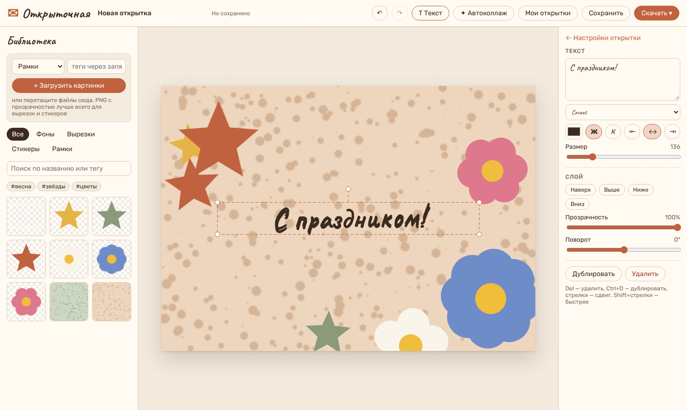

# Открыточная — генератор открыток-коллажей (MVP)

Веб-приложение для сборки открыток в стиле коллажа / скрапбукинга из своей библиотеки элементов.



## Запуск

```bash
npm install
npm run dev      # http://localhost:5173
npm run build    # production-сборка в dist/
```

Нужен Node.js 20+.

## Что умеет MVP

- **Библиотека элементов**: загрузка картинок (кнопкой или перетаскиванием файлов), категории *фоны / вырезки / стикеры / рамки*, теги, поиск, фильтр по тегу, редактирование и удаление элемента. Большие фото автоматически уменьшаются до 2400 px по длинной стороне.
- **Ручной редактор** (Konva.js): клик или перетаскивание элемента на открытку, перемещение, поворот (с прилипанием к 45°), масштаб, отражение, прозрачность, порядок слоёв, дублирование, undo/redo (100 шагов). Фон всегда ложится вниз и заменяет предыдущий, рамка растягивается на всю открытку.
- **Форматы**: A6 и A5 для печати (300 dpi), квадрат, пост и сторис для соцсетей. При смене формата композиция пересчитывается.
- **Текст**: 5 шрифтов с кириллицей (Caveat, Amatic SC, Marck Script, Playfair Display, Rubik), цвет, размер, жирный/курсив, выравнивание. Двойной клик по тексту открывает поле редактирования.
- **Автоколлаж**: случайный фон + 3–7 вырезок и стикеров с лёгким наклоном; при включённом тексте центр остаётся свободным. Можно ограничить тему тегом и добавить рамку.
- **Экспорт**: PNG, JPG и PDF (для печатных форматов PDF в мм нужного размера).
- **Черновики**: сохранение, автосохранение после первого сохранения, список «Мои открытки» с превью, копирование и удаление.

### Горячие клавиши

Ctrl+Z / Ctrl+Shift+Z (или Ctrl+Y) — отмена/повтор, Ctrl+D — дублировать, Ctrl+S — сохранить, Del — удалить, стрелки — сдвиг (Shift — быстрее), Esc — снять выделение.

## Архитектура

Без бэкенда: всё хранится в браузере в **IndexedDB** (картинки как Blob, открытки как JSON). Один пользователь, одно устройство.

```
src/
  types.ts        модели: Asset, CardNode (image/text), CardDoc, Draft
  formats.ts      форматы холста и шрифты
  db.ts           IndexedDB (idb)
  library.ts      стор библиотеки (zustand), загрузка и кэш картинок
  editor.ts       стор редактора: документ, выделение, история undo/redo
  autoLayout.ts   алгоритм автоколлажа
  exporters.ts    PNG/JPG/PDF
  drafts.ts       сохранение черновика с превью
  components/     Toolbar, Library, CardCanvas, Inspector, Drafts
```

Документ открытки хранится в «реальных» пикселях формата (например 1748×1240 для A6), а на экране холст просто масштабируется, поэтому экспорт всегда в полном разрешении.

## Что дальше (идеи)

- Аккаунты и облачное хранение (бэкенд + S3), чтобы библиотека была доступна с разных устройств.
- Автоудаление фона у загруженных фото (вырезки «в один клик»).
- Рваные края и маски для фото, тени у вырезок.
- Шаблоны раскладок и «перемешать ещё раз» с сохранением выбранных элементов.
- Импорт/экспорт библиотеки архивом.
