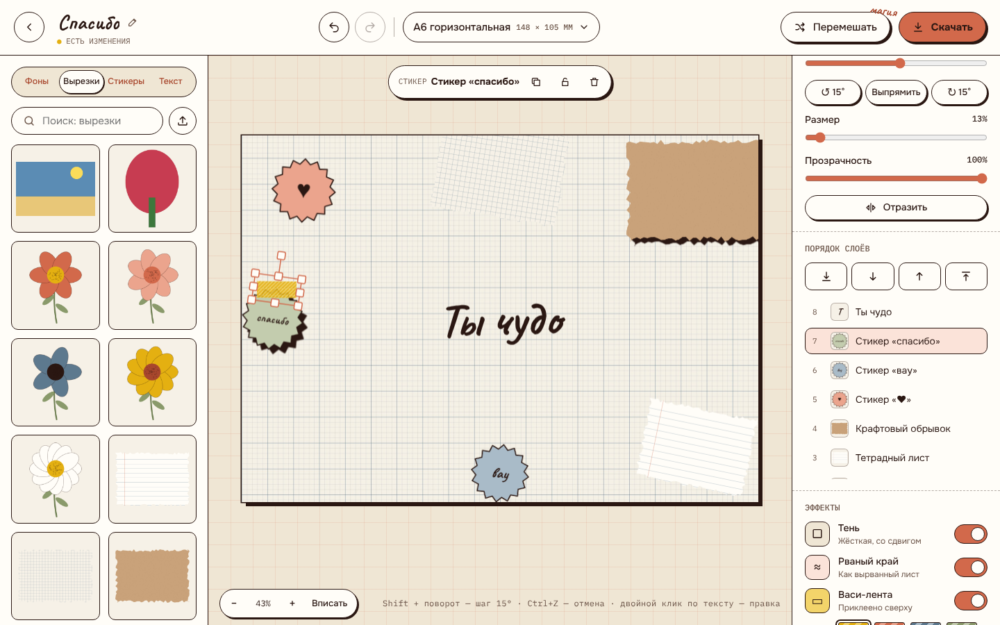
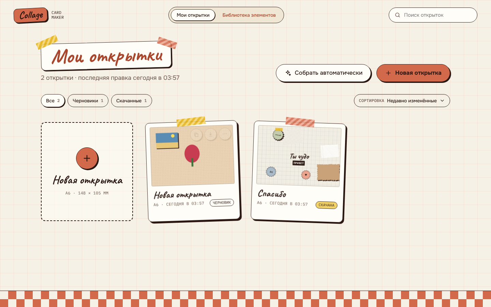
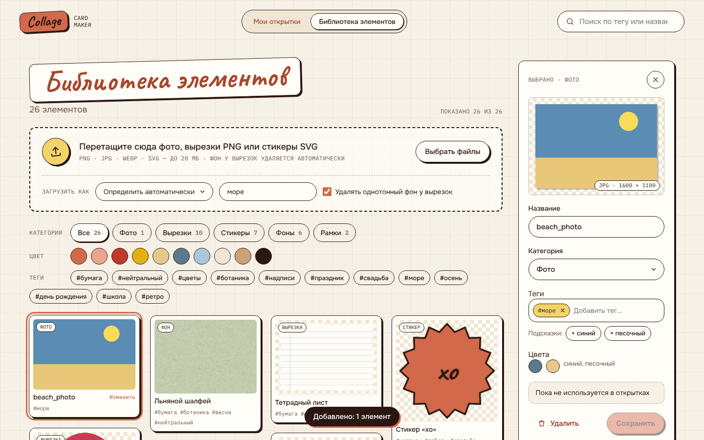
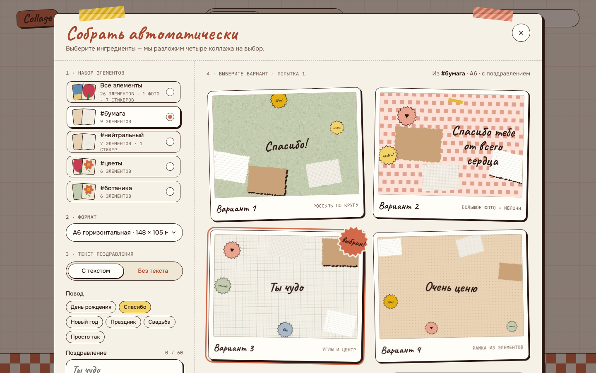
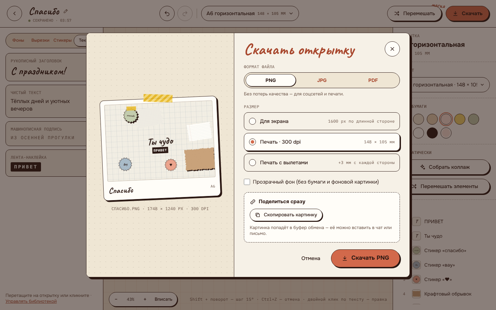

# Collage Card Maker — открытки-коллажи

Веб-приложение для сборки открыток в стиле коллажа и скрапбукинга из своей библиотеки элементов: вручную на холсте или автоматически, с текстом или без.



## Запуск

```bash
npm install
npm run dev      # http://localhost:5173
npm run build    # production-сборка в dist/
```

Нужен Node.js 20+. Бэкенд не нужен: всё хранится в браузере (IndexedDB).

## Экраны

| Мои открытки | Библиотека |
|---|---|
|  |  |
| **Собрать автоматически** | **Скачать** |
|  |  |

## Возможности

**Мои открытки.** Сетка «полароидов» с превью, фильтр «Все / Черновики / Скачанные», поиск по названию и тексту, сортировка, быстрые действия при наведении: дублировать, скачать, переименовать, удалить. Пустое состояние с подсказками.

**Библиотека элементов.** Загрузка перетаскиванием или кнопкой (PNG, JPG, WEBP, SVG до 20 МБ). Категории: фото, вырезки, стикеры, фоны, рамки; категория может определяться автоматически по прозрачности. У вырезок на однотонном фоне фон удаляется автоматически (или кнопкой позже). Цвета элемента определяются сами, по ним можно фильтровать. Теги с подсказками, поиск, панель редактирования, «где используется». Стартовый набор из 25 нарисованных элементов, чтобы сразу было с чем работать.

**Редактор.**
- Слева вкладки «Фоны / Вырезки / Стикеры / Текст», поиск, быстрая загрузка, цвет бумаги. Клик добавляет элемент, перетаскивание ставит его в нужное место.
- Холст на Konva: перемещение, поворот (Shift — шаг 15°), масштаб, 8 маркеров, наведение подсвечивает элемент пунктиром.
- Панель над холстом: дублировать, заблокировать, удалить.
- Справа свойства: поворот и кнопки ±15°/«Выпрямить», размер, прозрачность, отражение, порядок слоёв и список слоёв, эффекты «Тень», «Рваный край», «Васи-лента» (4 цвета). Для текста: шрифт (6 шрифтов с кириллицей), цвет, жирный/курсив, выравнивание, «лента-наклейка».
- Стили текста: рукописный заголовок, чистый текст, машинописная подпись, лента-наклейка.
- Undo/redo (120 шагов), автосохранение, зум (кнопки, Ctrl+колесо, Ctrl +/−/0), «Перемешать» раскладку.
- Форматы: A6 и A5, евро, квадрат, пост 4:5, сторис. При смене формата композиция пересчитывается.
- На планшетах левая панель сворачивается в рейку.

**Собрать автоматически.** Выбор набора (вся библиотека или тег), формата, повода и поздравления (пустое поле подставит фразу под повод), рамки. Четыре варианта в разных стилях раскладки: россыпь, большое фото, углы, рамка из элементов. Вариант открывается в редакторе или ставится на текущую открытку.

**Скачать.** PNG (можно с прозрачным фоном), JPG с регулировкой качества, PDF в физическом размере. Размеры: для экрана, печать 300 dpi, печать с вылетами +3 мм. Копирование картинки в буфер обмена и «Отправить…» на устройствах с системным меню «Поделиться».

### Горячие клавиши

Ctrl+Z / Ctrl+Shift+Z (Ctrl+Y) — отмена/повтор · Ctrl+D — дублировать · Ctrl+S — сохранить · Del — удалить · стрелки — сдвиг (Shift — быстрее) · Esc — снять выделение · Ctrl+колесо, Ctrl +/−/0 — зум.

## Архитектура

```
src/
  types.ts         модели: Asset, CardNode (image/text), CardDoc, Draft
  formats.ts       форматы холста, шрифты, палитра бумаги
  db.ts            IndexedDB (idb), миграция со старой версии
  library.ts       стор библиотеки, загрузка, кэш картинок
  imageTools.ts    декодирование, удаление фона, обрезка прозрачных полей
  colors.ts        определение цветов элемента
  starterKit.ts    процедурный стартовый набор
  editor.ts        стор редактора: документ, выделение, история
  effects.ts       тень, рваный край, васи-лента, измерение текста
  render.ts        независимый рендерер открытки (экспорт, превью, миниатюры)
  autoLayout.ts    автосборка и «Перемешать»
  drafts.ts        черновики и автосохранение
  pages/           Мои открытки, Библиотека
  editor/          Редактор: холст, панели
  dialogs/         Собрать автоматически, Скачать
  ui/              общие компоненты, иконки
```

Открытка хранится в реальных пикселях формата (A6 = 1748×1240 при 300 dpi), на экране холст лишь масштабируется, а экспорт рендерится отдельно в нужном размере.

## Что дальше

- Аккаунты и облачное хранение, чтобы библиотека и открытки были на всех устройствах; тогда же можно сделать ссылку «Поделиться».
- Удаление фона у сложных фото с помощью ML-модели.
- Множественное выделение и группировка элементов.
